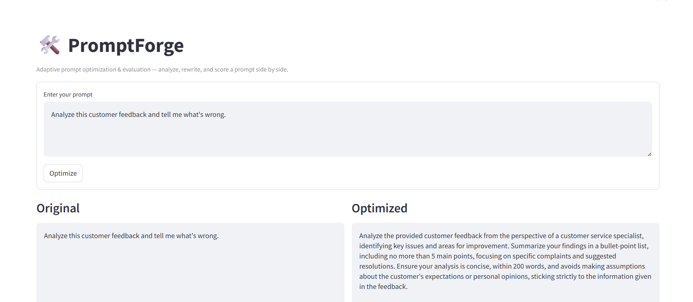
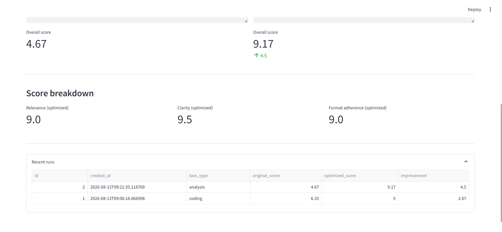

# 🛠️ PromptForge

**An adaptive prompt optimization and evaluation tool.** It analyzes a vague prompt, rewrites it using task-appropriate prompt-engineering techniques, and then *measures* whether the rewrite is actually better.

Most "prompt improver" tools just ask an LLM to rewrite your prompt and hope for the best. PromptForge closes the loop: **analyze → rewrite → score**, so every improvement comes with evidence.





## Results

| Original prompt | Original score | Optimized score | Improvement |
|---|---|---|---|
| Explain machine learning. | 3.33 | 9.17 | +5.84 |
| Analyze this customer feedback and tell me what's wrong. | 4.67 | 9.17 | +4.50 |
| Write a function to check if a string is a palindrome. | 6.33 | 9.00 | +2.67 |

Scores are on a 0-10 scale (average of relevance, clarity, and format adherence).

**Example**

Before:
> Explain machine learning.

After:
> Acting as a data science instructor, explain the fundamentals of machine learning in a step-by-step guide, providing a concise overview suitable for beginner programmers, focusing on supervised and unsupervised learning, within a 500-word limit, and organizing the response as: introduction, definition, types of machine learning, and real-world applications.

## How it works

```
User prompt
    │
    ▼
Input validation     empty / too long / injection-pattern flagging
    │
    ▼
Prompt analyzer      LLM call → task type, ambiguity, missing elements
    │
    ▼
Strategy selector    rule-based mapping: task type → techniques to apply
    │
    ▼
Prompt generator     LLM call → optimized prompt
    │
    ▼
Evaluator            deterministic checks + LLM judge, scores both prompts
    │
    ▼
Result + history     improvement delta, saved to SQLite
```

**Design choices**

- **Analyze before rewriting.** The intermediate analysis explains *why* the prompt is changed, instead of one opaque "make it better" call.
- **Rule-based strategy selection.** Mapping task types to techniques (e.g. classification → few-shot, reasoning → chain-of-thought) is well-understood domain knowledge, so a lookup table is deterministic and easy to debug.
- **Hybrid evaluation.** An LLM judge scores relevance, clarity, and format adherence, with a cheap deterministic check acting as a floor to reduce judge inconsistency.
- **Pydantic schemas between stages.** Malformed LLM output fails loudly at the boundary instead of corrupting later steps.

## Tech stack

Python · FastAPI · Pydantic · SQLAlchemy (SQLite) · Streamlit · Groq (Llama 3.3 70B)

## Project structure

```
promptforge/
├── backend/
│   ├── api/            FastAPI app and routes
│   ├── analyzers/      prompt analysis (stage 1)
│   ├── optimizers/     strategy selection + prompt generation (stages 2-3)
│   ├── evaluators/     scoring (stage 4)
│   ├── models/         Pydantic schemas
│   ├── security/       input validation
│   └── database/       SQLAlchemy models and session
├── frontend/           Streamlit UI
├── configs/            settings loaded from .env
├── tests/
└── requirements.txt
```

## API

| Method | Endpoint | Description |
|---|---|---|
| POST | `/optimize` | Analyze, optimize, and score a prompt |
| GET | `/history` | Recent optimization runs |
| GET | `/health` | Liveness check |

## Limitations and next steps

- The evaluator scores the *prompt itself*. A more rigorous version would run both prompts through a model and compare the resulting *responses*.
- The strategy table is hand-written. Tuning it against more observed task types is the natural next step.
- Each request makes four LLM calls, so free-tier rate limits can be hit during heavy testing. Graceful handling of provider rate-limit errors is planned.
- Planned: an iterative refinement loop, few-shot example retrieval with sentence embeddings, and automated tests for the LLM-calling stages.
